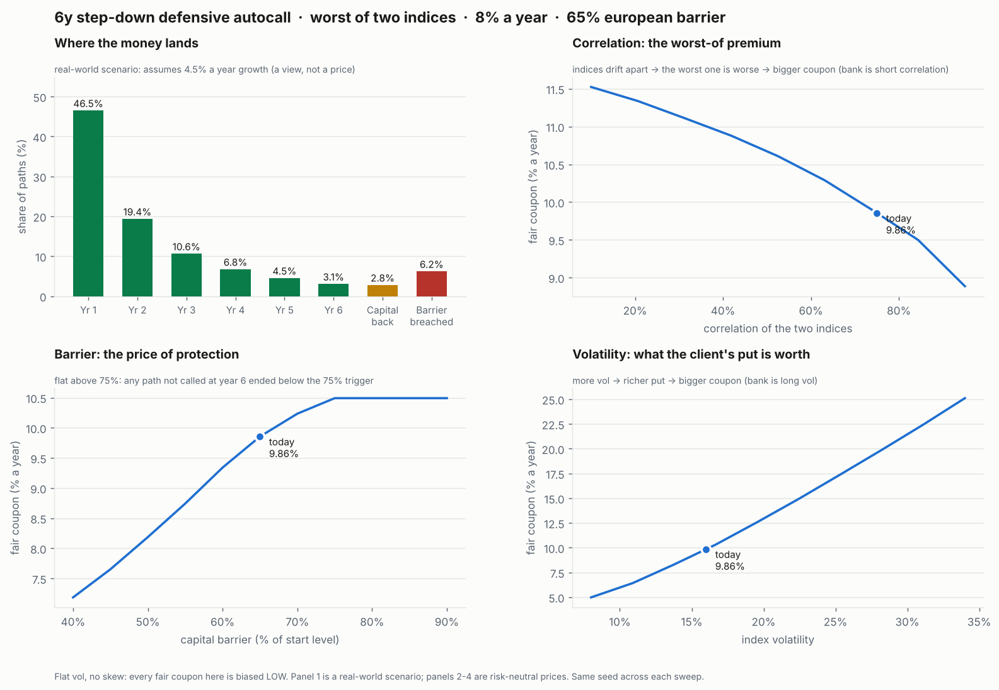

# Autocall Pricer
[](https://github.com/ohunter-dev/autocall/actions/workflows/ci.yml)

A Monte Carlo pricer for the most widely sold structured product in the world: a 6-year step-down autocall on the worst of two equity indices. I built it in four stages (payoff, market simulation, pricing, desk risk), checking each against hand-worked numbers before moving on.

I pitch structured products to clients in my day job. I built this to understand what sits underneath them: where the coupon comes from, what the client is really selling, and which risks the bank is left holding.



## The product

| Term | This note |
|---|---|
| Underlyings | Worst of two equity indices |
| Tenor | 6 years, checked once a year |
| Autocall triggers | 100%, 95%, 90%, 85%, 80%, 75% (step-down) |
| Coupon | 8% a year, paid in full when called |
| Capital barrier | 65%, european (checked at maturity only) |

If the worst index is at or above that year's trigger, the note is called and pays back capital plus every coupon so far. If it's never called, the client gets their capital back as long as the barrier held. If it didn't, they get the worst index's final level.

## What I found

`python -m autocall.run`:

```
  fair coupon             9.89% a year
  value at 8% coupon     0.9700 per 1.00 paid  (gap of 3.0%: margin, distribution, funding)
------------------------------------------------------------------------
  RISK-NEUTRAL (pricing only, not a forecast)
    called: yr1 38.8%  yr2 17.5%  yr3 10.2%  yr4 6.8%  yr5 5.0%  yr6 3.9%
    capital back  4.4%   loss 13.4%
  REAL-WORLD (assumes 4.5% a year growth)
    called: yr1 46.4%  yr2 19.8%  yr3 10.7%  yr4 6.7%  yr5 4.5%  yr6 3.2%
    capital back  2.7%   loss  6.1%
------------------------------------------------------------------------
  desk risk: move one input, re-price
    base case                                   9.95%
    correlation 0.75 -> 0.95                    8.99%    -96bp
    correlation 0.75 -> 0.30                   11.20%   +125bp
    volatility +5 points                       13.97%   +402bp
    dividends +1% a year                       11.61%   +166bp
    barrier 65% -> 55%                          8.84%   -111bp
    barrier 65% -> 75%                         10.64%    +69bp
    barrier 75% -> 85%                         10.64%     +0bp
    american barrier (vs european, monthly)    10.53%    +58bp
```

**1. The client is selling the bank a put.** At maturity the payout is `1 + min(W - 1, 0)`: a put struck at 100%, switched on by the barrier. The coupon is the premium for that put, paid in instalments. The barrier doesn't cap the loss. End at 65.0% and you get 100 back, end at 64.9% and you get 64.9.

**2. The fair coupon solves in one line.** Whether and when a path is called never depends on the coupon, so the note's value is a straight line in it: `value = A + coupon x B`. Setting that equal to 100 gives `coupon = (1 - A) / B` with no trial and error. That's why `payoff.py` keeps the capital part (`base`) and the coupon years (`years`) separate.

**3. The 3-point gap is how the product gets paid for.** The note can afford 9.9% a year but pays 8%, so it's worth about 97 per 100 invested. That gap covers the bank's margin, the distributor's fee and the issuer's funding.

**4. Two sets of probabilities, and only one is for clients.** Pricing uses risk-neutral growth (interest rate minus dividends), because that's the cost of hedging and doesn't depend on anyone's view. Those percentages aren't chances of anything. The real-world run assumes 4.5% a year growth, which is an opinion, and here it's the more flattering set. Clients should only ever see clearly labelled scenarios, including the bad ones.

**5. The bank ends up long vol, long dividends and short correlation.** My rule for reading the risk table: the client sells the bank a put, and the coupon is what the bank pays for it. So if the fair coupon rises when X goes up, the bank is long X. If it rises when X goes down, the bank is short X.

| Input | Client | Bank, before hedging | How the bank offloads it |
|---|---|---|---|
| Volatility | short vol | **long vol** | sells options elsewhere |
| Dividends | short dividends | **long dividends** | sells dividend futures |
| Correlation | long correlation | **short correlation** | hard: there's little direct market for it |

Dividends matter because a dividend paid out drops the share price by the cash paid, so higher dividends mean slower index growth and more knock-ins.

**6. A barrier above the final trigger does nothing.** Any path not called at year 6 ended below the 75% trigger, so it's below any barrier of 75% or higher. The barrier panel goes flat from 75%.

## Run it

```
python -m venv .venv
.venv\Scripts\activate          # Windows; on Mac/Linux: source .venv/bin/activate
pip install -r requirements.txt

python -m autocall.run          # price, outcomes, risk table (about 3 seconds)
python -m autocall.plots        # the four-panel figure -> docs/
pytest -q                       # 22 tests
```

## Modules

| File | What it does |
|---|---|
| `autocall/payoff.py` | The term sheet, and what the note pays on one path |
| `autocall/paths.py` | Correlated price paths for the two indices |
| `autocall/pricing.py` | Discounting, the note's value, and the one-line fair coupon |
| `autocall/risk.py` | Re-prices with one input moved at a time |
| `autocall/run.py` | Prints everything above |
| `autocall/plots.py` | The four-panel figure |

The tests check the payoff against eleven paths worked out by hand (including the cliff at the barrier, the worst-of, and american vs european), the simulated paths against their known averages, spreads and correlation, and the direction of every risk in the table.

## Limitations

- **Flat vol, no skew.** Real markets charge more for downside puts than at-the-money ones. The client is selling exactly that downside put, so every fair coupon here is biased low. A desk would use a model fitted to the vol smile.
- **No issuer credit or funding.** A real note is the bank's own debt, and its funding cost feeds straight into the coupon.
- **Flat rates and dividend yields**, not a discount curve and dividend futures.
- **Two indices, one correlation.** Bigger baskets need a full correlation matrix.
- **Monthly barrier checks for the american case.** Real notes often check daily, so the american premium here is a little understated.
- **Monte Carlo noise.** Fair coupons move by about ±10bp between seeds. The risk table uses the same random numbers for every row, so the differences between rows are reliable even where the levels aren't exact.
